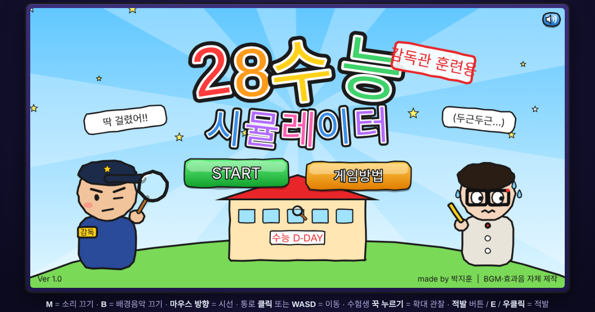
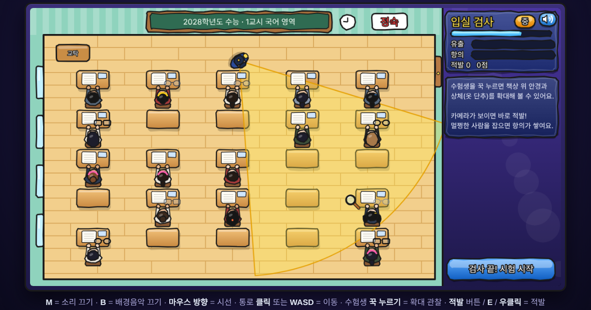
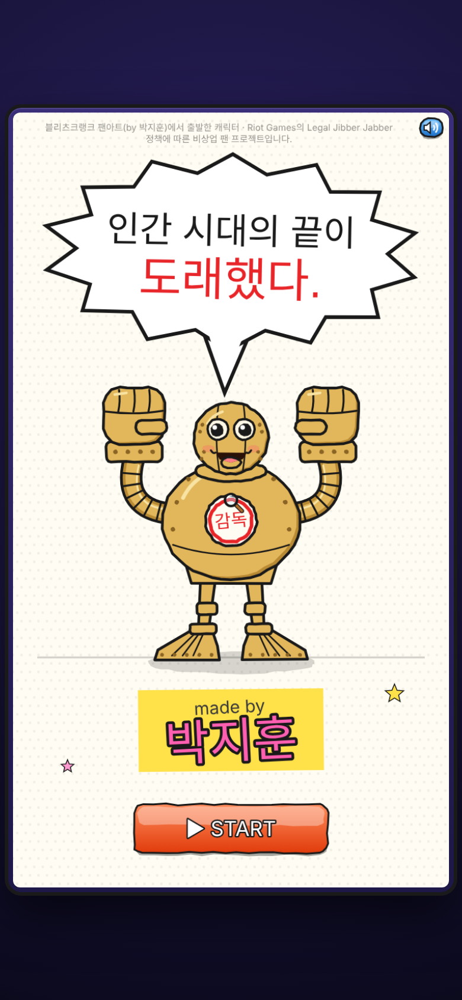

# 28수능 시뮬레이터

> **2028학년도 수능, 당신은 감독관이다.**
> 더욱 화려해진 손기술과 거듭된 눈치싸움 속에서, 당신은 부정행위를 잡아낼 것인가?

2000년대 플래시게임 감성의 웹게임입니다. AI 안경, 단추 카메라, 펜 카메라로 커닝하는 수험생을 **행동 단서만으로** 잡아내세요.

▶ **바로 플레이: https://toothlessispeter.github.io/28suneung-simulator/**

| 타이틀 | 시험장 |
|---|---|
|  |  |

| 로딩 (가로) | 로딩 (폰 세로) |
|---|---|
|  |  |

## 게임 방법
1. **입실 검사**: 시험 전에 책상 위 안경과 수험생 상체를 확대해서 수상한 장비를 찾아요.
2. **시험 시간**: 교실을 돌아다니며 시선을 돌려요. 커닝러는 **감독관이 안 볼 때만** 움직여요.
3. **적발**: 수상한 수험생을 꾹 눌러 확대 관찰한 뒤 적발! 멀쩡한 사람을 잡으면 **항의 게이지**가 쌓여요.
4. 커닝을 놓치면 **유출 게이지**가 차요. 둘 중 하나가 가득 차면 끝!

| 조작 | 방법 |
|---|---|
| 이동 | 클릭·탭 / WASD |
| 시선 | 마우스(터치) 방향 |
| 확대 관찰 | 수험생 꾹 누르기 |
| 적발 | 적발 버튼 / E / 우클릭 |
| 소리 | M 전체 끄기 · B 배경음악 끄기 · 오른쪽 위 스피커 버튼 |

**난이도**: 하 · 중 · 상. 학생 수, 커닝러 수, 숨기는 속도, 카메라 크기가 달라지고, 상에서는 얇은 테 AI 안경이 등장해요.

## 특징
- 외부 이미지·음원 없이 **HTML 파일 하나**로 동작 (캔버스 손그림 렌더링 + WebAudio 8비트 합성)
- 1초에 8번 꿈틀거리는 손그림 선(boil), 비트크러셔를 거친 투박한 효과음과 BGM
- 폰에서는 화면을 줄이지 않고 **720×1280 세로 전용 레이아웃**으로 플레이
- 로딩 화면 대사는 제작자가 직접 녹음

## 실행
```bash
git clone https://github.com/toothlessispeter/28suneung-simulator.git
# index.html을 브라우저로 열면 끝
```

## 스튜디오
**인간시대의 끝이 도래했다.** — 2000년대 플래시게임 감성 인디 스튜디오, made by 박지훈
유튜브 · 인스타그램 · 틱톡 `@ingansidae.end`

스튜디오 공통 규칙은 [STUDIO_CONTEXT.md](STUDIO_CONTEXT.md)에 있어요.

## 고지
- 등장하는 뉴스와 사건은 게임용으로 다시 쓴 **가상 뉴스**이며, 실존 인물·단체와 관계없습니다.
- 스튜디오 캐릭터 황동봇은 제작자가 그린 블리츠크랭크 팬아트에서 출발했습니다. 이 프로젝트는 Riot Games의 Legal Jibber Jabber 정책에 따른 비상업 팬 프로젝트이며, Riot Games가 보증하거나 후원하지 않습니다.
- 실제 부정행위 방법을 알려 주는 게임이 아니며, 감독관 시점에서 상황을 풍자합니다.

## License
코드: MIT · 그림·녹음 음성·캐릭터: © 박지훈, 무단 재사용 금지
